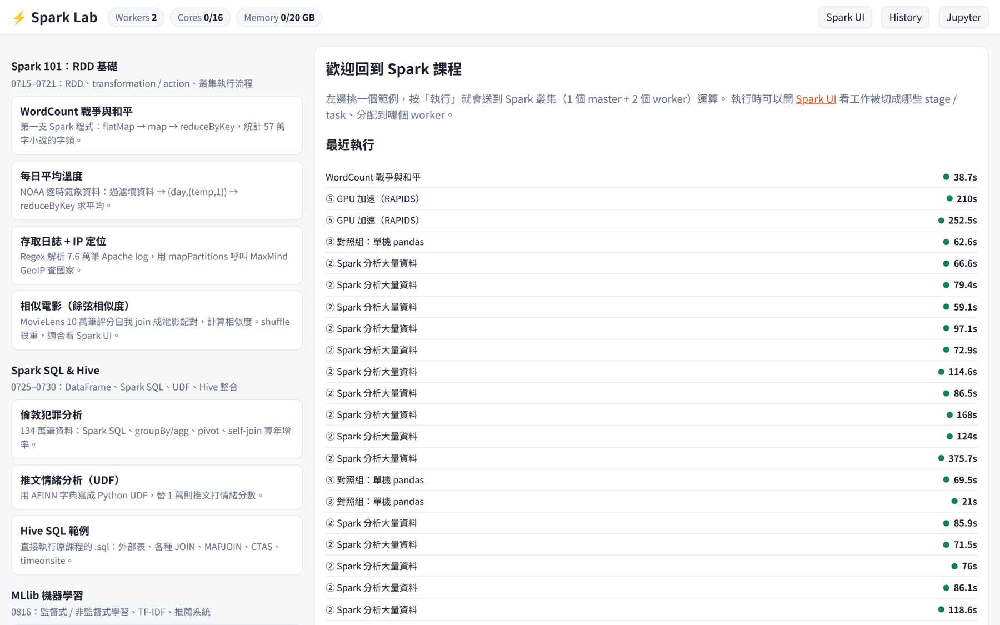
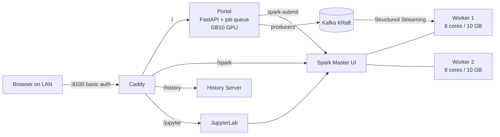
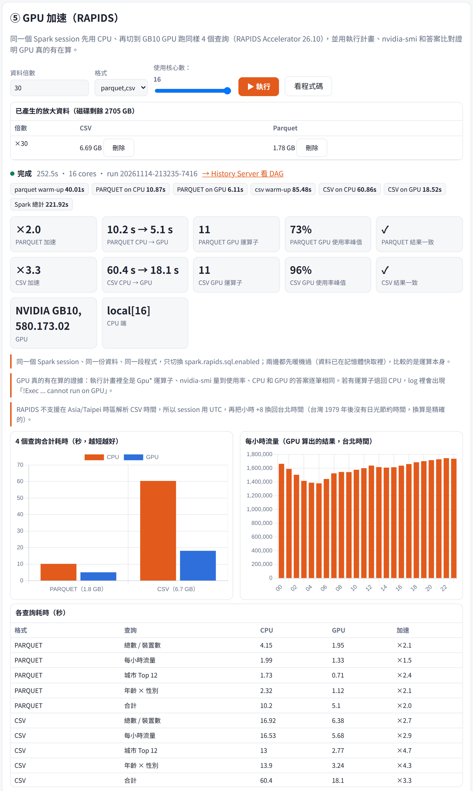

# Spark Lab on DGX Spark

A complete Apache Spark teaching lab — a 2020 Spark course (Spark 2.4, Hadoop, Hive, Kafka 0.10) rebuilt
on **Spark 4.1.2 + Kafka 4.3 (KRaft)** and running entirely in Docker on an **NVIDIA DGX Spark**
(GB10 Grace-Blackwell, aarch64). Every exercise runs from a web console on the LAN — no terminal needed —
and a "Power of Spark" track measures scaling, file formats, and GPU acceleration on tens of millions of rows.





## What's inside

| Track | Demos |
|---|---|
| **Spark 101** (RDD) | word count, average temperature, Apache access-log analysis with IP geolocation, item-based movie similarity |
| **Spark SQL / Hive** | London crime analytics, tweet sentiment with a Python UDF, HiveQL (external tables, joins, broadcast join, CTAS, time-on-site with window functions) |
| **MLlib** | Titanic (LogisticRegression / RandomForest), SMS spam (TF-IDF pipeline), ALS recommendations, gender prediction + per-user KMeans on e-commerce logs |
| **Final project** | Quadkey (Bing tile) region lookup with a prefix tree, ETL to Parquet, gender / age-group models, per-device location clustering with `applyInPandas`, dashboard |
| **Streaming** | Kafka → Structured Streaming: per-visitor sliding windows (60 s / 5 s) written back to Kafka; live tweet-sentiment ranking (300 s / 20 s) |
| **Power of Spark** | data amplification (×N, tens of GB), core-scaling benchmark, CSV vs Parquet, single-node pandas baseline, **CPU vs GPU with RAPIDS** |
| **Advanced** | watermark vs late data (one Kafka topic, several queries that differ only in watermark, checked against the truth); Delta Lake 4.4 — MERGE, time travel + RESTORE, OPTIMIZE ZORDER data skipping, VACUUM |

## Results (DGX Spark, ×30 = 38.3 M rows)

| Cores | CSV (6.7 GB) | Parquet (1.8 GB) |
|---|---|---|
| 1 | 239 s | 96 s |
| 4 | 88 s | 38 s |
| 16 | 56 s | 35 s |
| pandas, 1 core (extrapolated) | 139 s, 9 GB RAM | 46 s, 5 GB RAM |

| Same session, local[16] | CPU | GPU (RAPIDS 26.10) | Speed-up |
|---|---|---|---|
| Parquet | 10.2 s | 5.1 s | ×2.0 |
| CSV | 60.4 s | 18.1 s | ×3.3 |

Measured on the original course data; the synthetic data shipped here has the same schema and size.

<details>
<summary>Screenshot: the GPU job's result page (speed-ups, GPU utilization, answer check, per-query timings)</summary>



</details>

## Engineering notes

- **Caching made Parquet slower.** The first Parquet run reused the CSV strategy (`.cache()` first) and gained
  only 53 s → 44 s. Profiling showed building the cache cost 22 s — more than re-reading the 5 needed
  columns. CSV now caches; Parquet reads directly: 37 s → 12.5 s for the same four queries.
- **Why scaling is sub-linear.** GB10 has 10 performance + 10 efficiency cores, and other host services hold
  3–4 cores; Parquet stops improving after 8 cores because the remaining ~30 s is fixed scheduling / JIT cost.
- **RAPIDS on a GPU that isn't on the support list.** GB10 / sm_121 is not listed, but the `cuda13-arm64` jar
  works. Getting full GPU plans required: a smaller RMM pool (unified memory reports only ~17 GB free of
  75 GB), session time zone UTC because CSV timestamp parsing in `Asia/Taipei` falls back to CPU (Taipei hour
  = (UTC hour + 8) % 24, exact since Taiwan has no DST), and `ParquetCachedBatchSerializer` for caching.
  GPU use is proven three ways: `Gpu*` operators in the final AQE plan, `nvidia-smi` utilization, and
  row-by-row comparison with the CPU answers.
- **Built for a host that never reboots.** Docker log rotation, Spark worker app-dir cleanup, executor log
  rolling, Kafka segment rolling so retention actually applies, checkpoint cleanup, and a cap on stored runs.
- **Bootstrap tested from a fresh clone**, beside a running stack (separate compose project and port). That
  test found two bugs the dev machine could never show: a SIGPIPE under `pipefail` and a missing
  `spark-events` directory.
- **Migration.** DStream + `spark-streaming-kafka-0-8` → Structured Streaming; ZooKeeper Kafka → KRaft;
  HDFS / YARN / Hive Metastore → Spark's built-in catalog with the HiveQL unchanged.

## Quick start

Requirements: Docker with Compose v2. For the GPU demo: NVIDIA driver R580+ and the NVIDIA Container Toolkit.
Built and tested on DGX Spark (aarch64); the image is multi-arch, so x86_64 should work for the CPU demos.

```bash
git clone https://github.com/laurenttang/spark-lab-dgx.git
cd spark-lab-dgx/platform
./bootstrap.sh            # .env with a random password, RAPIDS jar, image, datasets, start
# NO_GPU=1 ./bootstrap.sh # skip the 538 MB RAPIDS jar
```

Open `http://<host>:8100/` and log in as `spark` with the password printed by the script (also in `platform/.env`).
The first run downloads ~250 MB of public datasets and generates the synthetic ones (about 10–15 minutes).

## Repository layout

| Path | Contents |
|---|---|
| `platform/` | Docker Compose stack, Spark config, Caddy, portal (FastAPI + vanilla JS), notebooks |
| `platform/jobs/` | every demo as a plain PySpark program (also runnable with `spark-submit`) |
| `platform/README.md` | operations manual (Chinese): architecture, verification commands, design decisions, pitfalls |
| `tools/prepare_data.py` | downloads public datasets and generates the synthetic ones |
| `data/` | datasets, mounted read-only at `/data/course` |
| `NOTICE.md` | data sources and licenses |

## Credits

Exercises adapted from a 2020 Apache Spark course and ported to Spark 4. Dataset credits and licenses are in
[NOTICE.md](NOTICE.md). IP geolocation by [DB-IP](https://db-ip.com).
